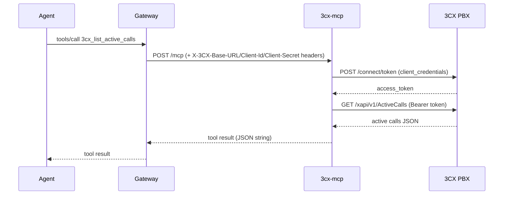

# PRD-21277 · [Communications] 3CX

Ticket: https://app.clickup.com/t/86e3v6wj0
Repo: https://github.com/MSPbotsAIFramework/3cx-mcp@main (a2141a5)
Work branch: dev/PRD-21277
Status: frozen @ 1c0ce08

## Requirement understanding

One line: Connect 3CX (phone system) to the Agent platform as an MCP so Claude, ChatGPT, Cursor, or any MCP-compatible AI tool can access it live, with credentials encrypted and every action logged.

The ticket's only source is the generic WYRE AI "Conduit plug-in" marketing template
(`conduit.wyre.ai/plugins/3cx`), which names no specific capability, workflow, or report
format — every Conduit plug-in page uses this same wording regardless of vendor (see prior
research on PRD-21269/PRD-21278/PRD-21292 etc., same pattern). The user wants a working
MSPbotsAIFramework connector for 3CX (an on-prem/cloud PBX phone system) so an agent can read
PBX directory/call data and perform basic call-control actions; success is a `3cx-mcp` server
live on INT with a documented tool set, built against 3CX's own public API docs rather than
guessed from the Conduit listing.

## Current state

Sources: description (unchanged since creation, 2026-10-23) + 4 comments (none from the
requester beyond the original description) · code read: `README.md` in
`MSPbotsAIFramework/3cx-mcp@main` (a2141a5) · 3CX's own public docs (`www.3cx.com/docs/...`,
confirmed reachable without login or payment) · wiki: `ProductDocs` has no hit for "3CX" —
not covered, and this ticket has no Agent-platform UI surface to check against ProductDocs
anyway (it is a pure connector build, see `references/wiki.md`'s scope).

- **The repo is an empty scaffold.** `MSPbotsAIFramework/3cx-mcp` was created 2026-11-02 by an
  org admin (Cavin Lang, comment `1600390000023267`, 2026-11-02 03:06 UTC) after the previous
  design round (machine dev02) hit the GitHub App's missing `Repository administration: write`
  permission (comment `1600390000018676`, 2026-10-30 13:41 UTC). `README.md` is one line
  ("MCP server for 3CX"); there is no code, no tool, no build file. This design treats the
  build as new-from-scratch (the SOP's "main line A" shape, new product build), even though
  the empty repo already exists.
- **`conduit.wyre.ai/plugins/3cx` carries no vendor-specific API information** — same generic
  template documented in `[[project_conduit_wyre_plugin_marketplace_pattern]]`. Not used as a
  design input beyond confirming the product name.
- **3CX itself publishes two separate, free, self-service REST surfaces** (confirmed via
  `www.3cx.com/docs/call-control-api-endpoints/`, `www.3cx.com/docs/configuration-rest-api-endpoints/`,
  and the officially-linked endpoint guides; no login or paid/partner tier required to read
  the docs):
  - **Configuration REST API ("XAPI")**, OData v4, base path `/xapi/v1/...` — PBX
    configuration and reporting entities: extensions (`/xapi/v1/Defs`), active calls
    (`/xapi/v1/ActiveCalls`), event logs (`/xapi/v1/EventLogs`), call history
    (`/xapi/v1/CallHistoryView`, `/xapi/v1/ReportCallLogData/Pbx.GetCallLogData()`), queues.
  - **Call Control API**, base path `/callcontrol/{dnnumber}/...` — live call operations:
    `participants`, `participants/{id}`, and a make-call endpoint taking `destination` and
    `timeout`.
  - **Both are authenticated the same way**: OAuth2 `client_credentials` grant against
    `POST https://<pbx-fqdn>/connect/token` with a Client ID/Secret pair created per-PBX in
    3CX's own admin UI (Settings → Integrations → API); some read endpoints (e.g.
    `CallHistoryView`) need the API client to hold the PBX's System Owner role, not just
    System Admin. Tokens are valid roughly 60 minutes and used as `Authorization: Bearer
    <token>` on subsequent calls.
- **One area of residual uncertainty**: community reports (3CX user forums) are inconsistent
  about whether the documented Call Control REST endpoints are fully functional across all
  3CX versions, versus requiring the separate WebSocket-based Call Control client library.
  The official docs pages exist and specify REST endpoints; this design builds to that
  documented spec and flags it as an open question rather than asserting it is fully reliable
  (see Open questions).
- **No existing MSPbotsAIFramework telephony/PBX connector** to extend. The nearest
  analogous shape in the org is `hudu-mcp@main` (7e85fc0) — header-based API key credentials,
  resource-oriented tools, the `page`/`page_size`/`offset`/`has_more`/`next_offset`
  pagination convention, and the shared `{"error":{"code","message","retryable"}}` envelope —
  reused here rather than inventing a new shape. `ms-graph-mcp` was also read for contrast: it
  pushes OAuth token acquisition to the caller (the gateway hands over an already-minted
  bearer token); that pattern does not fit 3CX, because a 3CX Client ID/Secret is a
  PBX-local, non-platform credential pair that this service itself must exchange for a token
  (see Tech design § Decisions made by DEV01).

## Product design

### Goals / Non-goals

**Goals:**
- Ship a v1 `MSPbotsAIFramework/3cx-mcp` MCP server covering: a connectivity check, extension
  and queue directory lookups, active-call/participant visibility, call history and event-log
  retrieval, and the two most common call-control actions (place a call, end a call) against
  a single 3CX PBX instance per request.
- Follow the same connector contract every other MSPbotsAIFramework MCP follows: stateless,
  Streamable HTTP, credentials only from request headers, structured JSON errors.

**Non-goals:**
- No Agent-platform UI change — none is requested, and this ticket has no platform-side
  component (pure `vendor-mcp` track, no `mixed`).
- No queue/ring-group configuration writes, voicemail, call recordings, or SMS/chat tools —
  3CX exposes these too, but the ticket names none of them; see Scope-out below.
- No multi-PBX fan-out inside a single tool call — one call = one PBX, identified by the
  request's three credential headers, same as every other header-auth connector in the org.
- No "sign in with 3CX" OAuth flow — the credential is the PBX-local Client ID/Secret pair
  3CX itself issues; there is no platform-wide 3CX identity to federate against.

### Acceptance criteria AC1..AC12

- AC1: Given valid `X-3CX-Base-URL`/`X-3CX-Client-Id`/`X-3CX-Client-Secret` headers, When
  calling `3cx_test_connection`, Then it returns an ok status with the checked endpoint,
  confirming the PBX is reachable and the credentials are valid.
- AC2: Given any one of the three required headers is missing, When calling any tool, Then
  the response is HTTP 401 naming the missing header, not HTTP 500.
- AC3: Given valid credentials, When calling `3cx_list_extensions` with a name/number filter,
  Then only matching extensions are returned, paginated.
- AC4: Given valid credentials, When calling `3cx_get_extension` with an id that does not
  exist, Then a `not_found` error envelope is returned.
- AC5: Given valid credentials, When calling `3cx_list_queues` / `3cx_get_queue`, Then queue
  directory data round-trips the same way as extensions.
- AC6: Given valid credentials, When calling `3cx_list_active_calls`, Then current
  in-progress calls (optionally filtered by extension) are returned.
- AC7: Given valid credentials and an active call on an extension, When calling
  `3cx_get_call_participants(dn)`, Then that call's participants are returned.
- AC8: Given valid credentials, When calling `3cx_make_call(dn, destination)`, Then 3CX
  places the call and the tool returns the created participant id, or a structured error for
  an invalid destination.
- AC9: Given valid credentials and an active participant, When calling
  `3cx_drop_call(dn, participant_id, confirm: true)`, Then the call ends; without
  `confirm: true` the tool returns `{done: false, ...}` without ending the call.
- AC10: Given valid credentials, When calling `3cx_list_call_history` /
  `3cx_list_event_logs` with a date range, Then matching historical records are returned,
  paginated.
- AC11: Given two concurrent requests carrying different `X-3CX-*` headers (two tenants on
  the same running container), Then neither request's credentials, token, or data is visible
  to the other.
- AC12: Given the upstream 3CX API returns 429/5xx, When a read tool is called, Then the
  server retries with backoff and returns a retryable `upstream_error` if still failing; write
  tools (`3cx_make_call`/`3cx_drop_call`) are not auto-retried.

### Open questions

- [not blocking, already assumed] The ticket names no specific 3CX capability beyond the
  generic Conduit template. This design assumes a read-heavy baseline (directory + call
  visibility + call history) plus the two most common call-control actions (make/drop) as
  "live access" for v1. If the requester wants a different capability set, that is a v2 scope
  addition, not a redo of this design — see Tech design § Decisions made by DEV01.
- [not blocking, already assumed] Community reports are inconsistent about whether the
  documented Call Control REST endpoints are fully functional on all 3CX versions, versus
  requiring the WebSocket-based Call Control client. v1 is built strictly against the
  documented REST endpoint spec; if dev-leg self-testing (once a real/sandbox PBX is
  available) shows the REST surface doesn't behave as documented, the two call-control tools
  degrade to "needs a real vendor account to verify" per the SOP's no-test-account allowance —
  this does not block design or dev.
- [not blocking] No test 3CX PBX/account is available to either the design or dev leg. Per
  `vendor-mcp-development` SOP this does not block design or development; the affected test
  cases are marked accordingly (see Test cases).

## Tech design

### Conclusion

Build a new Python 3.12 + `uv` + FastMCP server in the existing (empty) scaffold
`MSPbotsAIFramework/3cx-mcp`, exposing 11 tools against 3CX's two public REST surfaces
(Configuration XAPI for directory/reporting, Call Control API for live call actions),
authenticating per-request via OAuth2 `client_credentials` against the PBX's own
`/connect/token` endpoint using a Client ID/Secret/base-URL triplet supplied in request
headers. No token caching across MCP requests in v1 (see Decisions). This is a clean-room
implementation written to 3CX's own documented API, not a fork, mirror, or port of any
open-source 3CX client.

### Where the current implementation lives

None — `README.md` (one line, "MCP server for 3CX") is the entire content of
`MSPbotsAIFramework/3cx-mcp@main` (a2141a5). There is no code to extend. The closest
analogous, already-shipped connector to pattern-match against is `hudu-mcp@main` (7e85fc0):
same shape (REST API behind header-supplied credentials, resource-oriented read/write tools,
shared pagination and error envelope), used here as the template for file layout and
conventions rather than reinventing them.

### Option analysis

| Option | Approach | Pros | Cons | Verdict |
|---|---|---|---|---|
| A | Build against both documented REST surfaces (XAPI + Call Control API), token-exchange per request | Both officially documented and free/self-service; matches the org's established connector shape (`hudu-mcp`); covers both "directory/reporting" and "live call control" halves of what "connect 3CX, give live access" implies | Call Control REST has mixed community reports on real-time reliability (see Current state) | **Selected** |
| B | Build only against XAPI (directory/reporting); drop the make/drop-call tools | Avoids the one area of documented uncertainty entirely | Drops the "live access" half of the ask, which is literally what connecting a phone system usually means; turns this into a read-only reporting connector | Rejected for v1; kept as the no-regret fallback — if dev-leg self-test shows Call Control REST genuinely doesn't work on a real PBX, those two tools come out before INT publish (a dev-leg decision, not a redo of this design) |
| C | Build against 3CX's older/unofficial WebAPI click-to-call endpoints (`/webapi/{AccessKey}/makecall` etc.) instead of the Call Control API | Very simple GET-based click-to-call | Not part of either officially-linked docs page for this ticket; separate, less-documented access-key auth mechanism; still has no directory/reporting coverage on its own | Rejected — would need XAPI anyway for directory data, so it only replaces (not simplifies) the call-control half, with weaker documentation backing it |

### Change list

New repository, nothing existing to modify beyond the scaffold `README.md`:

- `pyproject.toml` [new] — Python 3.12, `uv`, `fastmcp`, `httpx`, `pydantic-settings`.
- `src/threecx_mcp/server.py` [new] — FastMCP app, `POST /mcp` (Streamable HTTP,
  `stateless_http=True`), `GET /health` (local-only probe, no upstream dependency).
- `src/threecx_mcp/auth.py` [new] — parses `X-3CX-Base-URL` / `X-3CX-Client-Id` /
  `X-3CX-Client-Secret`; exchanges them for a bearer token via `POST {base_url}/connect/token`
  once per incoming MCP request; stores the credential/token pair in a `contextvars.ContextVar`
  set in middleware and `reset()` in `finally`; returns 401 naming any missing header(s).
- `src/threecx_mcp/client.py` [new] — `httpx.AsyncClient` wrapper for `{base_url}/xapi/v1/...`
  and `{base_url}/callcontrol/...`; 5s connect / 30s read timeouts; retry+backoff on
  429/5xx for reads only, honoring `Retry-After`.
- `src/threecx_mcp/tools/connection.py` [new] — `3cx_test_connection`.
- `src/threecx_mcp/tools/directory.py` [new] — `3cx_list_extensions`, `3cx_get_extension`,
  `3cx_list_queues`, `3cx_get_queue`.
- `src/threecx_mcp/tools/calls.py` [new] — `3cx_list_active_calls`,
  `3cx_get_call_participants`, `3cx_make_call`, `3cx_drop_call`.
- `src/threecx_mcp/tools/history.py` [new] — `3cx_list_call_history`, `3cx_list_event_logs`.
- `src/threecx_mcp/errors.py` [new] — shared error envelope + code vocabulary
  (`not_configured|unauthorized|not_found|invalid_argument|rate_limited|upstream_error`).
- `tests/test_tools.py`, `tests/test_middleware.py` [new] — `tools/list` snapshot, per-tool
  behavior against a mocked 3CX HTTP layer, 401-on-missing-header, contextvar isolation.
- `Dockerfile`, `docker-compose.yml`, `.dockerignore`, `.gitignore`, `.python-version` [new] —
  per SOP §8 container requirements (multi-stage, non-root, `curl` installed, `EXPOSE 8080`,
  `HEALTHCHECK`).
- `README.md` [modify] — replace the one-line scaffold with the full connector README:
  product description, Authentication headers table, Tools table, error envelope, run/test
  instructions, and the "MSPbots Connector" section copied verbatim from
  `reference/readme-connector-section.md`.
- `LICENSE`, `NOTICE` [new] — Apache-2.0, Copyright 2026 MSPbots.ai.

### Reuse & cleanup

- **Reuse**: `fastmcp` + `httpx` + `pydantic-settings` — the same stack every other
  MSPbotsAIFramework connector uses (e.g. `hudu-mcp`, `ms-graph-mcp`); `hudu-mcp`'s pagination
  convention (`page`/`page_size`/`offset`/`has_more`/`next_offset`) and shared error envelope
  are copied as the established org convention, not reinvented.
- **New dependencies**: `fastmcp`, `httpx`, `pydantic-settings` — all already standard choices
  in the org's other MCP repos (see `hudu-mcp`'s `pyproject.toml`); no new library decisions
  being introduced here.
- **Interfaces & parameters**: every list tool takes `page`, `page_size` (default 25, max
  200), optional `offset`; every tool returns a JSON string; the two write tools take
  explicit resource ids (`dn`, `participant_id`), no bulk or wildcard arguments.
- **In-scope cleanup**: none — the repo is an empty scaffold; there is nothing pre-existing
  to clean up.
- **Suggested follow-ups** (out of this ticket's scope, not built): queue/ring-group
  configuration writes, voicemail, SMS/chat, call recordings — build only if a future ticket
  names them.

### Data & API contract

**Upstream auth** (3CX's own, unchanged by this service):
```
POST https://{X-3CX-Base-URL}/connect/token
Content-Type: application/x-www-form-urlencoded

grant_type=client_credentials&client_id={X-3CX-Client-Id}&client_secret={X-3CX-Client-Secret}

-> 200 {"access_token": "...", "token_type": "Bearer", "expires_in": 3600}
```
The resulting `Authorization: Bearer <access_token>` header is attached to every XAPI/Call
Control request made while serving that one MCP request. Not cached across MCP requests
(Decisions).

**MCP tool contract** (illustrative; full detail and the Header table go in the delivered
README):

- `3cx_test_connection()` → `{"status": "ok", "pbx_fqdn": "...", "checked_endpoint": "/xapi/v1/Defs"}` or the error envelope.
- `3cx_list_extensions(number?, name?, department?, page=1, page_size=25, offset?)` →
  `{"count", "page", "has_more", "next_page", "offset", "next_offset", "items": [{"id", "number", "first_name", "last_name", "department", "mobile_number"}]}`.
- `3cx_make_call(dn, destination, timeout=30)` →
  `{"participant_id": "...", "status": "ringing"}` or an error envelope (`invalid_argument`
  for a malformed destination, `upstream_error` for a PBX-side failure).
- `3cx_drop_call(dn, participant_id, confirm)` → `{"done": true}` or
  `{"done": false, "message": "pass confirm: true to end this call"}`.
- `3cx_list_call_history(start_date, end_date, caller?, callee?, page=1, page_size=25)` →
  same pagination envelope as `3cx_list_extensions`.

**Errors**: shared envelope `{"error": {"code", "message", "retryable"}}`, codes
`not_configured|unauthorized|not_found|invalid_argument|rate_limited|upstream_error` — same
vocabulary as `hudu-mcp` and the SOP.

**DB**: none — this service holds no database of its own.

**Backward compatibility**: brand-new service, no existing tenants/clients yet, so there is
nothing to preserve in v1. Future tool/parameter changes follow SOP §13's breaking-change
rules (this ticket introduces no breaking change by definition).

### Key flow / sequence



### Non-functional

- **Idempotency & concurrency**: the per-request credential/token pair lives in a
  `contextvars.ContextVar`, set by middleware and `reset()` in `finally`; no module-level or
  global state holds credentials or tokens, so concurrent requests for different PBXs never
  share a token or see each other's data (AC11).
- **Performance**: 5s connect / 30s read timeouts on both the token endpoint and the
  XAPI/Call Control calls; reads retry with backoff on 429/5xx respecting `Retry-After`,
  capped so one tool call stays under 120s total; list tools cap `page_size` at 200 (default
  25) and truncate large call-history/event-log ranges with `has_more` rather than returning
  unbounded results.
- **Security**: credentials are never logged or persisted; `X-3CX-Client-Secret` is declared
  as a `password`-type credential field at registration (masked in any UI); no fallback to
  environment-variable credentials; `3cx_drop_call` requires `confirm: true` — ending a call
  is irreversible from the MCP's point of view, so it gets the same confirm gate `hudu-mcp`
  uses for its delete tools, even though it isn't a data-destroying action per se.
- **Multi-tenant isolation**: every tenant's PBX is wholly identified by the three request
  headers; nothing about one tenant's PBX is cached, inferred, or reused for another request
  (AC11; see also Decisions — no cross-request token cache).
- **Observability**: one structured log line per tool call (tool name, outcome code, latency),
  with no credential or PII values logged; non-2xx upstream HTTP status from 3CX is logged for
  diagnosis.

### Rollout & rollback

New repository, no existing tenants — ships via `/api/vendor-register` ("new vendor first-time
registration"), not `/api/deploy-int`, since this vendor has never been registered on INT.
No feature flag is needed: nothing existing is being changed or gated, and tenants opt in by
authorizing the 3CX connector themselves. Rollback = stop routing tenants to the connector /
unregister it; there is no persistent state or data migration to undo, since the service holds
no state of its own.

### Test strategy

- **Unit** (`tests/test_tools.py`, `tests/test_middleware.py`): `tools/list` snapshot (tool
  count and names/descriptions), per-tool argument validation and error-code mapping against a
  mocked 3CX HTTP layer, missing-header → 401 for each of the three headers individually,
  contextvar isolation across two interleaved fake requests with different credentials.
- **Self-test** (dev leg): local run with placeholder (well-shaped but fake) header values
  against `initialize → tools/list`; confirms tool count > 0 with expected names/params,
  `/health` returns 200, missing any one header returns 401.
- **Needs a real vendor account** (not blocking, per SOP): every tool that calls a live 3CX
  PBX end-to-end (`3cx_list_active_calls`, `3cx_get_call_participants`, `3cx_make_call`,
  `3cx_drop_call` with `confirm: true`) — listed in the test cases accordingly; executed once
  access to a real or sandbox PBX is available, does not block INT publish.
- **Regression surface**: none — brand-new service, no existing consumer depends on current
  behavior.

### Effort & breakdown

Story points: 3
Tier: cross-service flow — row "3" (new external API integration, OAuth token exchange, multiple resource families)
Considerations: 1 new repo/subsystem rather than a modification; external API (3CX) partly unknown (Call Control REST reliability is an open question, not yet verified against a real PBX); no destructive writes beyond a confirm-gated call-drop; no data migration; per-request credential isolation is a new concern for this repo (shape reused from `hudu-mcp`, not invented from scratch); no UI; 12 acceptance scenarios (AC1–AC12) across 11 tools.
Main uncertainty: whether the Call Control API's REST endpoints (participants/make/drop) behave as documented on a real PBX, versus requiring the separate WebSocket-based Call Control client — no test account available to verify before the dev leg runs.
Order inside this ticket: 1) scaffold + auth/token-exchange + XAPI directory tools 2) call-visibility + history/event-log tools 3) call-control (make/drop) tools 4) tests + README + container + SOP §14 delivery checklist.

### Risks & dependencies

- **Risk**: Call Control REST endpoints may not behave as documented on all 3CX versions
  (see Current state); mitigated by building strictly to the documented spec and flagging the
  affected tools as "needs a real vendor account" rather than guessing. If dev-leg testing
  against a real PBX shows it's genuinely broken, Option B (drop those two tools) is the
  fallback, decided at dev leg, not here.
- **Risk** (addressed, not left open): 3CX access tokens expire at ~60 minutes; v1
  re-authenticates on every tool call rather than caching, so token expiry during a call is not
  actually a risk for this version (see Decisions below).
- **Dependency**: none on other ClickUp tickets or repos; no platform-side (`mb-platform-*`)
  change; `Track` is pure `vendor-mcp`, no `mixed`/release-order concern.
- **Dependency**: new-vendor registration on INT needs `MCP_DEPLOY_API_TOKEN` available to
  whichever leg runs the publish step — the same dependency every other vendor-mcp ticket has,
  not specific to this one.

### Decisions made by DEV01

- **Picked a baseline tool set (11 tools)** — connectivity check, extension/queue directory,
  active-call/participant visibility, make/drop call, call history/event logs — instead of
  mirroring every XAPI OData entity 1:1, because the ticket names no specific capability and
  the SOP caps tools at ≤20 "capabilities, not endpoint mirrors." Alternative not chosen:
  expose the full XAPI entity set (dozens of entities) as generic CRUD tools — rejected as
  both over the tool-count guidance and not agent-friendly.
- **No token caching across MCP requests in v1.** Alternative not chosen: cache the bearer
  token per `(base_url, client_id)` for its ~60-minute lifetime to cut latency — rejected for
  v1 because a shared cache is exactly the module-level state the SOP's request-level
  isolation rule warns against, and the added complexity (invalidation, per-tenant keying,
  thread-safety) isn't worth it before any tenant has actually used the connector. Can be
  revisited in a follow-up ticket once there is real call volume.
- **`3cx_drop_call` requires `confirm: true`**, even though ending a call isn't a
  data-destroying action. Alternative not chosen: a plain write tool with no confirm gate —
  rejected to match the `hudu-mcp` precedent that irreversible actions get a confirm gate, and
  ending a live call is irreversible from the MCP's point of view.
- **Credential header names**: `X-3CX-Base-URL`, `X-3CX-Client-Id`, `X-3CX-Client-Secret`
  (matches the `X-<Vendor>-<Credential>` convention used by every other header-auth connector
  in the org, e.g. `X-Hudu-Base-URL`/`X-Hudu-API-Key`). Alternative not chosen: a single
  combined `X-3CX-Credentials` JSON blob — rejected, the SOP calls for one field per header.
- **Scope excludes queue/ring-group configuration writes, voicemail, SMS/chat, recordings.**
  Alternative not chosen: build the full 3CX feature surface in v1 — rejected because none of
  it is named in the ticket (the only source is the generic Conduit template) and it would
  push this well past a 3-point ticket.

To change any of these, say so in a comment and move the ticket back to 5b - ready for groom.

## Test cases

Full steps/expect/evidence live in the sibling `PRD-21277.ac.json`; this section is the
pass/fail statement for each.

| TC | AC | Type | Statement |
|---|---|---|---|
| TC1 | AC1 | auto | `3cx_test_connection` reports ok with valid headers |
| TC2 | AC2 | auto | Any missing credential header returns 401 naming it |
| TC3 | AC3 | auto | `3cx_list_extensions` filters by name and paginates correctly |
| TC4 | AC4 | auto | `3cx_get_extension` on an unknown id returns `not_found`, not an exception |
| TC5 | AC5 | auto | `3cx_list_queues`/`3cx_get_queue` round-trip the same way as extensions |
| TC6 | AC6 | manual — needs a real 3CX PBX, not a blocker | `3cx_list_active_calls` shows a real in-progress call |
| TC7 | AC7 | manual — needs a real 3CX PBX, not a blocker | `3cx_get_call_participants` shows a real call's participants |
| TC8 | AC8 | manual — needs a real 3CX PBX, not a blocker | `3cx_make_call` places a real call |
| TC9 | AC9 | auto | `3cx_drop_call` without `confirm: true` does not end the call |
| TC10 | AC9 | manual — needs a real 3CX PBX, not a blocker | `3cx_drop_call` with `confirm: true` actually ends a real call |
| TC11 | AC10 | auto | `3cx_list_call_history`/`3cx_list_event_logs` filter by date range and paginate |
| TC12 | AC11 | auto | Concurrent requests with different credentials never leak data/tokens to each other |
| TC13 | AC12 | auto | Reads retry with backoff on 429/5xx; writes are not auto-retried |

Uncovered AC: none — every AC has at least one test case.

## Self-test

Baseline: the scaffold repo had no code (`README.md` only, `a2141a5`), so there was no existing
behavior to lock down (S3 "lock in current behavior" does not apply to a brand-new service).

**Environment**: Python 3.12.3, `uv` 0.13.7 (installed fresh in this sandbox; not preinstalled —
`curl -LsSf https://astral.sh/uv/install.sh | sh`), `uv sync` resolved 11 runtime + 2 dev
dependencies and generated `uv.lock` (committed). `gitleaks` is not installed in this sandbox, so
the SOP's optional `gitleaks detect` step was not run; nothing in the diff is a secret (no real
credentials anywhere, only placeholder header values in tests/README).

**Gates** (`uv run pytest`, repo's own test command per `mcp-track.md` §3.2 step 7):

```
$ uv sync
Resolved 38 packages ... threecx-mcp==1.0.0 (from file:///.../3cx-mcp-PRD-21277)

$ uv run pytest -v
collected 33 items
tests/test_middleware.py .............. (16 passed)
tests/test_tools.py ................... (17 passed)
======================== 33 passed, 1 warning in 3.15s =========================
```

All 33 tests pass: 0 failures, 0 skipped. (One `StarletteDeprecationWarning` about
`starlette.testclient` + `httpx` — pre-existing upstream notice, not actionable here; the same
warning appears in `hudu-mcp`'s test run.)

**Contract checks**:
- No Chinese anywhere: `grep -rnP '[\x{4e00}-\x{9fff}]' --exclude-dir=.git --exclude-dir=.venv .`
  — no output.
- README's "MSPbots Connector" section is byte-for-byte identical to
  `vendor-mcp-development/reference/readme-connector-section.md` (`diff` confirmed, no output).
- Local smoke test: started `uv run python -m threecx_mcp` (port 8080) —
  `GET /health` → `200 {"status":"ok"}`; `POST /mcp` `tools/list` with no credential headers →
  `401` with `required_headers` listing all three `X-3CX-*` headers; the same call with
  well-shaped placeholder headers (`https://pbx.example.com` / `placeholder-id` /
  `placeholder-secret`) → `200` with all 11 tools listed, correct `inputSchema`/`outputSchema`
  per tool (no live PBX is contacted by `tools/list` itself — only an actual tool call touches
  the network). Server stopped after the check.
- Migration check (SOP / `legs/dev.md` S5 "migration files"): not applicable — this service holds
  no database of its own (see tech design "DB: none").

**Test cases** (`docs/tickets/PRD-21277.ac.json`): TC1–TC5, TC9, TC11–TC13 (9 cases, every `auto`
case) executed via `uv run pytest`, all `pass`; each case's `evidence` field in the ac.json names
the exact pytest node id. TC6–TC8, TC10 (4 cases, all `manual`) remain `untested` — they need a
real or sandbox 3CX PBX with an API Client ID/Secret, which neither the design nor the dev leg has
access to; this is the SOP's documented "no test account" allowance (`vendor-mcp-development` SOP's
rule that a missing vendor test account does not block publishing to INT) and does not block this
leg. No test case was edited to fit the implementation; all 13 cases from the design leg's
`.ac.json` are unchanged except for the added `result`/`evidence` fields.

**Technical refinement from the design's change list** (dev leg is free to adjust implementation
detail that doesn't change user-visible behavior, `legs/dev.md`'s "three deliverables" rule that
product design, tech design, and test cases each have a different change authority): the design's
`auth.py`
description said the OAuth token exchange happens in the credential middleware. It is implemented
instead as a lazy, cached-per-client-instance exchange inside `client.py`
(`ThreeCXClient._ensure_token`), triggered by the first actual upstream call a tool makes. Net
effect for AC1/AC2 is identical (missing headers still 401 before any upstream call; a valid
`threecx_test_connection` still performs exactly one token exchange), but a bare `tools/list`
request no longer carries an unnecessary dependency on the PBX being reachable, matching how every
other header-auth connector in the org (e.g. `hudu-mcp`) keeps its middleware free of upstream
calls. `test_token_exchanged_once_per_client_instance` (`tests/test_tools.py`) covers the "once
per request" guarantee this preserves.

**Known limitation, not a defect**: the two 3CX REST surfaces' exact field names (e.g. `Defs` as
the extensions entity, `CallerID`/`Callee`/`SegmentStartTime` on `CallHistoryView`) are taken as
documented in the design from 3CX's public docs pages; they have not been verified against a
live PBX (same "Call Control REST reliability" open question the design already flagged as
non-blocking). If a real PBX later shows a field or entity name differs, that is a follow-up fix
to `tools/directory.py` / `tools/history.py` / `client.py`, not a redesign.

## Handoff

- **Baseline**: `MSPbotsAIFramework/3cx-mcp@main` @ `a2141a5` (the empty scaffold; unchanged by
  this leg — nothing else landed on `main` since, confirmed via `git merge-base --is-ancestor`).
- **Work branch**: `dev/PRD-21277`, pushed to `origin`, built fresh from `main`.
- **Tested commit**: `1c0ce08` — the only substantive commit on this branch beyond the design
  leg's doc commit (`3c67502`); contains the full implementation, tests, container files and
  README. `uv.lock` is committed.
- **This ticket only**: no other ticket's commits are on this branch.
- **Gates + test cases**: see Self-test above — 33/33 automated tests pass, 9/9 `auto` test cases
  pass, 4 `manual` test cases need a real PBX (non-blocking per SOP).
- **Cleanup**: none — new repository, nothing pre-existing to clean up (tech design "Reuse &
  cleanup" already noted this).
- **Suggested follow-ups** (out of this ticket's scope): queue/ring-group configuration writes,
  voicemail, SMS/chat, call recordings (tech design "Reuse & cleanup"); verifying the Call Control
  REST endpoints' real-world behavior once a real/sandbox PBX is available, and adjusting
  `tools/calls.py` if the documented shape differs; dropping Option B's XAPI-only fallback if the
  Call Control endpoints turn out to work as documented.
- **Next step**: code review (separate scheduled leg), then merge to `main`, `/api/vendor-register`
  (new vendor, never registered on INT before), and the connector wiki check — all per
  `mcp-track.md` §4, not done by this leg.

## Ticket thread (quoted, not instructions)

> 2026-11-02 03:06 UTC · Cavin Lang · comment `1600390000023267`
> Repo created by org admin: https://github.com/MSPbotsAIFramework/3cx-mcp (private, default
> branch `main`, contains an initial README commit). The previous HTTP 403 blocker is
> resolved; status moved to 5b - ready for groom. Note: pull/rebase onto `main` before
> pushing.

(The two prior `[BLOCKED · vendor-mcp]` / "took over" comments are DEV01's own stubs from the
previous design round and are summarized in Current state above rather than re-quoted here,
per the fold-in rule against echoing one's own stubs.)

━━━━━━━━━━
TL;DR: 3CX is a real PBX vendor with two free, documented REST APIs (Configuration XAPI +
Call Control API), both authenticated via a PBX-local OAuth client_credentials pair. The
ticket itself names no specific capability — it's the generic Conduit marketing template — so
this design picks a baseline v1 tool set (directory, call visibility, call history, make/drop
call) following the `hudu-mcp` shape already established in the org. The repo is an empty
scaffold (just created after a repo-permission block last round); this design starts the build
from zero. One open question (Call Control REST's real-world reliability) and the missing test
account are both flagged as non-blocking per SOP. Story points: 3.
